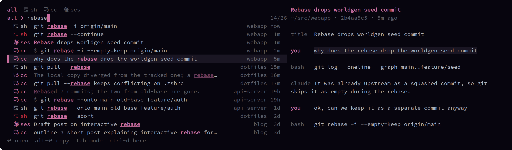

# histsearch

A kitty kitten that searches your shell history, your Claude Code sessions and your GitHub issues, pull requests and commits together. Ctrl+F opens it over the current window, and Enter either puts a command on your prompt, resumes a Claude session, or reads an issue in place.



## What it searches

| Tag | Source | Enter does |
|---|---|---|
| `sh` | your zsh history, from [atuin](https://atuin.sh)'s database | types the command on your prompt, unrun |
| `cc` | your prompts, Claude's replies and the Bash commands it ran, from `~/.claude/projects/*/*.jsonl` | resumes that session |
| `ses` | one row per Claude session, by title, with continuations merged | resumes that session |
| `gh` | open issues and pull requests of your GitHub account, and commits of the repos you are working in, through [`gh`](https://cli.github.com) | opens it in a viewer inside the popup |

Open issues and pull requests also show up in `all`. Rows are newest first. Search words match exactly, not fuzzily, so prose doesn't drown out results. A red `sh` tag means the command exited non-zero.

## Keys

| Key | |
|---|---|
| Enter | insert the command, or resume the session in a new tab |
| Alt+Enter | copy it instead |
| Tab / Shift+Tab | cycle mode: `all` → `sh` → `cc` → `ses` → `gh` |
| Ctrl+S / Ctrl+C | toggle shell-only / Claude-only |
| Ctrl+D | only entries from the directory you opened it in |
| Ctrl+P / Ctrl+N | earlier searches |
| Esc | close |

Each new open restores your last query, mode and cursor row.

### In `gh` mode

| Key | |
|---|---|
| Enter | read it in the popup (see below) |
| Ctrl+O | open it in your default browser (`xdg-open`) |
| Alt+Enter | copy its URL |
| Ctrl+D | step through the repos you are working in, then all |
| Ctrl+T | all (issues, pull requests and commits) → issues → pull requests → commits |
| Ctrl+S / Alt+S | next sort column (age, type, id, title, repo) / flip the direction |
| Ctrl+X | include closed issues and pull requests |

The viewer has pages, switched with Tab:

| Post | Pages |
|---|---|
| issue | body, comments, linked |
| pull request | body, comments, commits, diff, linked |
| commit | message, diff, linked |

"linked" lists the commits that reference an issue or pull request and the issues and pull requests that mention it, from GitHub's timeline; for a commit, the `#123` references in its message. On "commits" and "linked", the arrows move a cursor and Enter opens that entry in a viewer of its own; Esc returns to the one before, so an issue leads to a commit and on to its diff. Ctrl+O and Alt+Enter act on the selected entry there, and on the post itself elsewhere. The arrows, PgUp/PgDn, Space, `g` and `G` scroll text pages; Esc or `q` goes back.

"The repos you are working in" come from the focused pane. If it runs Claude Code, they are the repos that session has read, edited or run commands in, most recent first, so a session started in your home directory still finds them. A path that does not exist locally, such as one on a server reached over ssh, is matched by name against your GitHub repos. Without a Claude session, it is the repo of the current directory. The popup opens on the first of them.

Issues and pull requests come from `gh search` and are cached; the list shows the cache at once and refreshes it in the background when it is older than a minute. Commits come from the local clone's `git log`, or from the GitHub API for repos without one. Opening the browser from a pane that runs ssh or mosh works too, because the kitten runs in kitty on your machine.

## Configuration

`~/.config/histsearch/config.toml`, read on every press. Every key is optional; these are the defaults ([`config.example.toml`](config.example.toml)):

```toml
key = "ctrl+f"

passthrough = ["vim", "nvim", "vi", "view", "vimdiff", "gvim", "emacs", "emacsclient"]

herdr = true

gh_owners = []
```

- `key` opens the popup. After changing it, rerun `./install.sh` and reload kitty's config (Ctrl+Shift+F5).
- `passthrough` lists programs that get the key instead of the popup. Use `[]` to always open the popup.
- `gh_owners` lists the GitHub users or organisations whose issues and pull requests `gh` mode shows. Empty means the account `gh` is logged in as.
- `herdr` makes the popup look inside herdr panes: it checks the focused pane against `passthrough`, types commands into that pane, and resumes sessions in a new herdr tab. With `false`, herdr is treated like any other program.

## Install

Requires kitty, fzf (tested with 0.74), Python 3, and atuin hooked into zsh. Claude Code is optional, and so is the GitHub CLI, logged in, for `gh` mode.

```sh
./install.sh
```

That links this checkout to `~/.config/kitty/kittens/histsearch` and adds the key binding to `kitty.conf`, or updates the existing one.

For atuin, put this in `.zshrc`. The `CLAUDECODE` check keeps commands that Claude Code's agents run out of your history:

```sh
[[ -z $CLAUDECODE ]] && eval "$(atuin init zsh --disable-up-arrow --disable-ctrl-r)"
```

## How it works

| File | Runs in | Does |
|---|---|---|
| `main.py` | kitty itself (a no-UI kitten) | checks the foreground process; passes Ctrl+F through to editors or opens `ui.py` |
| `ui.py` | the overlay window | runs fzf, then acts on the choice back inside kitty (`handle_result`) |
| `hs.py` | plain `python3`, called by fzf | builds the index, prints rows and previews, switches modes |
| `ghmode.py` | imported by `hs.py` | fetches and caches GitHub data, finds the session's repos, renders previews and runs the viewer |

Transcripts are indexed into one TSV per session under `~/.cache/histsearch/cc/`. A session is only re-read when its transcript's size or mtime changes, so after the first build an open takes well under 100 ms. GitHub data is cached under `~/.cache/histsearch/gh/`. The last search and the `gh` filters live in `~/.local/state/histsearch/`. atuin's database is opened read-only.
